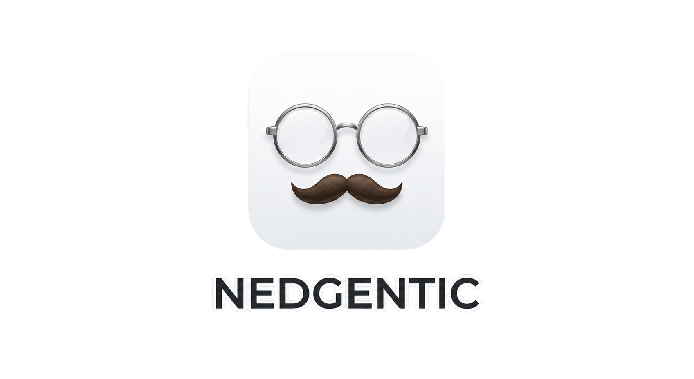

# Nedgentic

<p align="center">
  
</p>

Everyone is moving their agent sandboxes to the cloud, except when they
don't. I found that there were edge cases where I had to work with an agent
locally and wanted a secure place to operate from my laptop.

`ned` drops you into a sandboxed Linux VM on your Mac with Claude, Codex,
Gemini, Grok, and opencode one keypress away. The folder you start it from is
mounted read-write; nothing else on your Mac is touched.

## Requirements

- A Mac with Apple silicon running macOS 26 or later.
- Go 1.27.4 or newer to build `ned`.
- Homebrew (recommended). Ned installs or upgrades Apple's `container` runtime
  on first run.

## Get Started

```bash
make build-ned                 # builds bin/ned and copies it to ~/go/bin/ned
cd ~/src/my-project
ned gentic personal default
```

On first run Ned checks your Mac, installs the `container` runtime, writes the
`default` profile to `~/.ned/profiles/personal/default/config.hujson`,
downloads the minimal image from this release's GitHub assets (checked
against the sha256 built into `ned`), boots the VM, and mounts your folder at
the same path under the guest home. A dev build of `ned` does not download;
build the image with `make -C containers/arm64/minimal` (`ned-minimal:dev`).

The image ships no agent CLIs. Each one installs (latest release, official
installer) when you choose its sign-in. On every boot Ned reinstalls the CLI
of each signed-in provider and updates installed ones in the background (log:
`/var/log/ned-agent-update.log`); nothing is installed for providers you
skipped.

Type `exit` to detach. The VM keeps running; run the same command to reattach.

## Sign In

Ned never copies logins from your Mac. Provider tokens rotate when a CLI
refreshes them, so a copy would break the login on your Mac. Each VM signs in
for itself.

The first time you attach, the VM lists all five CLIs. Enter installs that CLI
(the first sign-in downloads it) and signs in, Down skips (remembered for this
VM; it is never installed), `q` quits. Each sign-in prints a link: open it in
your Mac's browser, approve, and paste the code back if asked. Gemini also
installs Node.js (latest LTS).

| CLI      | Sign-in it runs                               |
|----------|-----------------------------------------------|
| Claude   | `claude auth login`                           |
| Codex    | `codex login --device-auth`                   |
| Grok     | `grok login --device-auth`                    |
| Gemini   | `gemini` with `NO_BROWSER=true`, then `/auth` |
| opencode | `opencode auth login`                         |

Codex device sign-in must be enabled in your ChatGPT security settings. Run
`ned-agent-login` in the VM to revisit every CLI (sign in again, switch
accounts, or install one you skipped), or `ned-agent-install <cli>` to install
one without signing in.

Logins live on the VM's own disk (a `ned-auth-<vm>` volume). They survive
detach, `ned stop`, restarts, and VM recreation, and are deleted by
`ned remove`.

## Rotate Accounts

Every VM has its own logins, so each can use a different provider account.
When one hits a rate limit, switch to another VM on the same folder:

```bash
ned gentic personal default work-a   # terminal 1: account A
ned gentic personal default work-b   # terminal 2: account B
```

Both VMs see the same project files. If your browser is signed in to account A,
sign out or use another browser profile before approving account B. With
`--herdr`, each VM gets its own [HerdR](https://herdr.dev/) workspace.

## Desktop and Browser

The minimal image carries a tiny desktop: Chromium and a terminal (xterm) under
the JWM window manager, drawn on Xvfb and served by noVNC.

```bash
ned desktop [vm]          # start it and open it in your Mac's browser
ned desktop stop [vm]     # stop it
```

Without a VM name, `ned desktop` uses the `default` profile's VM. If macOS
asks, allow your browser Local Network access: the page is served from the
VM's address. The terminal opens in your workspace with your login shell, so
the agent CLIs you installed work there. Open more from the desktop menu (click the desktop
or the tray's Menu button), the tray buttons, or Ctrl+Alt+T (terminal) and
Ctrl+Alt+B (Chromium).

Agents in the VM drive the same screen with `DISPLAY=:1`; Chromium also serves
the DevTools protocol on `127.0.0.1:9222` inside the VM for Playwright/CDP.
Chromium runs with its sandbox on. In the VM, `ned-desktop start|stop|status`
manages it directly.

Only noVNC listens on the VM's address (port 6080, reached directly at the VM
IP); x11vnc and DevTools stay on the VM's loopback. Each fresh start makes a new
random VNC password (VNC uses 8 characters), stored 0600 in the VM and passed
only in the URL Ned opens. Other VMs on the same container network can reach
port 6080 but need that password.

## Commands

```bash
ned list                  # VMs and their status
ned exec <vm> -- <cmd>    # run a command in a VM
ned desktop [vm]          # open the VM's desktop in your browser
ned stop <vm>             # stop a VM (logins kept)
ned remove <vm>           # delete a VM and its logins
ned image pull <ref>      # pull an image
ned --help                # everything else
```

## Profiles

A profile is a HuJSON file (JSON with comments) at
`~/.ned/profiles/personal/<name>/config.hujson`. `ned gentic personal <name>`
creates it on first use. Example:

```json
{
  "shell": "/bin/bash",
  "image": "ned-minimal:dev",
  "resources": {
    "cpus": "2",
    "memory": "4G"
  },
  "imports": {
    "files": [
      { "host": "/Users/me/.env", "vm": ".env", "mode": "copy" }
    ],
    "directories": [
      { "host": "/Users/me/src", "vm": "src", "mode": "mount", "access": "readwrite" }
    ]
  }
}
```

- `imports.files` are copied into the VM through a private, read-only staging
  directory. `imports.directories` are bind-mounted (or copied with
  `"mode": "copy"`) and must be under your home directory.
- Host agent login paths (`~/.claude`, `~/.codex`, `~/.gemini`, `~/.grok`,
  `~/.local/share/opencode`) are rejected.
- `flags` holds advanced runtime overrides (network, DNS, proxies, Linux
  capabilities). Unknown keys fail the load.

`ned-minimal:<tag>` images are local only: Ned downloads its own release's tag
and never pulls other tags from a registry. Other images are pulled normally.
Private images: run `container registry login` and `container image pull`
first; Ned uses the local image.

## Security

The VM is the boundary. Only the workspace is mounted read-write; imported
files are copied in read-only. A compromised guest can change your project
files and use that VM's own provider logins, but cannot read other host files,
your Mac's logins, or another VM's logins.

## Development

```bash
go test ./...                       # unit + e2e (e2e needs the container runtime)
go vet ./...
go build -o bin/ned ./cmd/ned
make -C containers/arm64/minimal    # build the minimal image (ned-minimal:dev)
```

## Release

```bash
make release VERSION=v0.1.0
```

Builds `ned-minimal:v0.1.0`, saves it to `dist/ned-minimal-arm64.oci.tar.gz`,
and builds `dist/ned-darwin-arm64` with the version, asset URL, image name,
and archive sha256 embedded, plus `dist/SHA256SUMS`. It publishes nothing; it
prints the `gh release create` command to run. The image holds only Debian
packages and this repo's MIT scripts; agent CLIs are downloaded in the VM.
