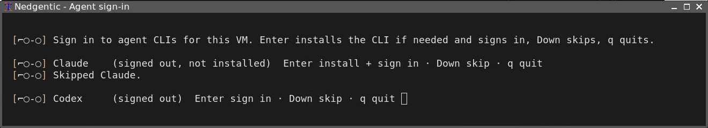
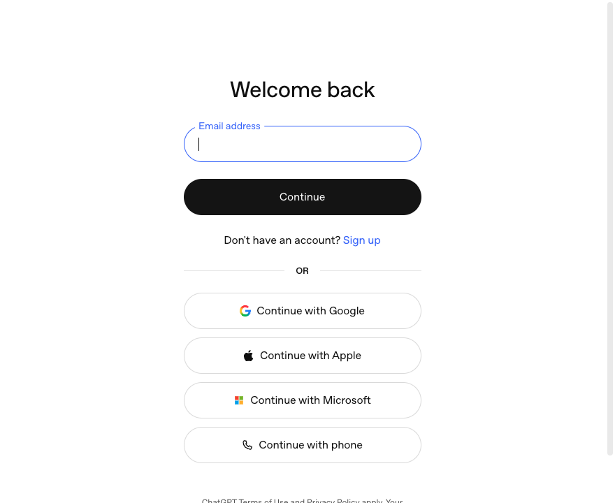
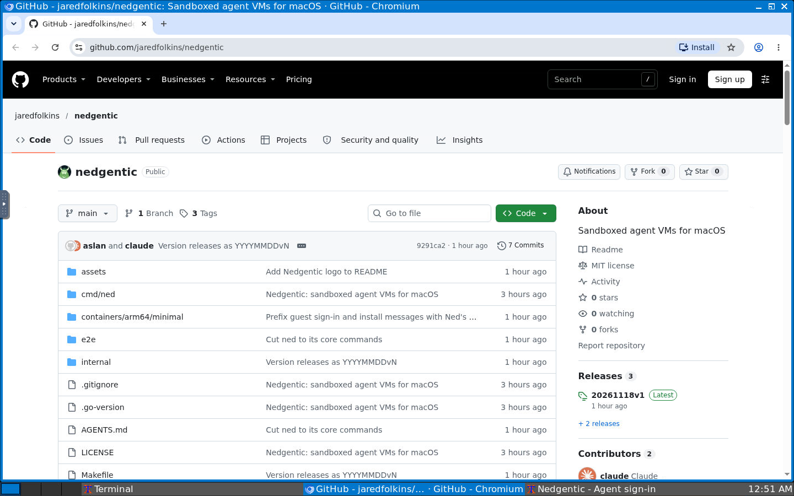

# Nedgentic

<p align="center">
  
</p>

I use cloud sandboxes when they fit. Ned is for the times I need an agent on a
checkout that's already on my Mac, without installing all its tools on the host
or sharing my host logins.

`ned` starts a Linux VM on Apple silicon and shares the folder you launch from.
The agent can edit that folder, and you can keep working on the same files from
macOS. Model requests still go to the provider you use.

## What it solves

| If you need to… | Ned lets you… |
| --- | --- |
| Work on a local checkout | Give the VM read-write access to that project folder, without sharing the rest of your home directory by default. |
| Try an agent without setting up another stack on your Mac | Install Claude, Codex, Gemini, Grok, or opencode in the VM when you choose it. Ned updates installed CLIs on boot. |
| Keep provider accounts separate | Sign in once per VM. Logins stay with that VM across restarts, so a different account can live in a different VM. |
| See what an agent is testing | Open the VM's Chromium and terminal from your Mac's browser with `ned desktop`. |

## Get started

You need an Apple silicon Mac running macOS 26 or later. Homebrew is recommended
for setting up Apple's `container` runtime.

Download `ned-darwin-arm64` from the
[latest release](https://github.com/jaredfolkins/nedgentic/releases/latest).
If you saved it in Downloads:

```sh
mkdir -p ~/go/bin
install -m 0755 ~/Downloads/ned-darwin-arm64 ~/go/bin/ned
cd ~/src/my-project
~/go/bin/ned gentic default vm-default
```

`default` is the profile. `vm-default` is the VM name.
The first run sets up the runtime if needed, verifies and loads the release's
VM image, and opens a shell in your project. Add `~/go/bin` to your `PATH` to use
`ned` directly.

## Sign in to an agent

In the VM, press **Enter** to install or sign in to the selected CLI, **Down**
to skip it, or **q** to go straight to the shell. Run `ned-agent-login` in the
VM to choose again later.



*Choose an agent in the VM. You don't have to install the ones you skip.*

Open the link printed in the terminal in your Mac's browser. Sign in there and
follow the provider's prompts. For Codex,
[enable device code login](https://learn.chatgpt.com/docs/auth#preferred-device-code-authentication-beta)
and enter the one-time code from the terminal when prompted.

<p>
  
</p>

*The Codex device link opens OpenAI's sign-in page on the Mac. Ned does not copy
your Mac's existing agent credentials into the VM.*

## Open the VM's browser

```sh
ned desktop vm-default
```

This opens the VM's desktop in your Mac's browser. Chromium runs **inside the
VM**, so you can use it to test a site running there without using your host
browser profile. If macOS asks for Local Network access, allow it so that your
browser can reach the VM.



*Chromium inside Ned's VM, viewed from the Mac through noVNC.*

## Day-to-day commands

```sh
ned list                          # see your VMs
ned gentic default vm-default     # reattach to the VM, or boot it
ned gentic default vm-work-b      # same project, separate VM and sign-in
ned desktop stop vm-default       # close the desktop, leave the VM running
ned stop vm-default               # stop the VM, keep its logins
```

Type `exit` in the VM shell to detach without stopping it. `ned remove vm-default`
deletes that VM **and its saved logins**. See `ned help` for the rest.

<details>
<summary>Profiles and agent tools</summary>

Ned creates `~/.ned/profiles/personal/<name>/config.hujson` the first time you
use a profile. Set `resources` to change CPU, memory, or disk; `image` to use a
different guest image; and `imports` to add files or folders. Files are copied
into the VM. Directory mounts must be under your home directory and can be
read-only. Ned rejects imports of host agent login paths.

Inside the VM, `ned-agent-install <cli>` installs a CLI without signing in. The
desktop uses `DISPLAY=:1`; guest Chromium's DevTools endpoint is
`127.0.0.1:9222` **inside the VM**. Use `ned gentic default vm-default --herdr`
to attach in [HerdR](https://herdr.dev/).

</details>

<details>
<summary>Build from source</summary>

With Go 1.27.4 or later, run:

```sh
make build-ned                         # builds and installs ~/go/bin/ned
make -C containers/arm64/minimal       # builds ned-minimal:dev for the dev CLI
go test ./internal/...
```

A dev build uses the local image; it does not download a release image.
`make release VERSION=YYYYMMDDvN` (with the actual date and release number)
prepares release assets without publishing them.

</details>
